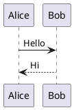
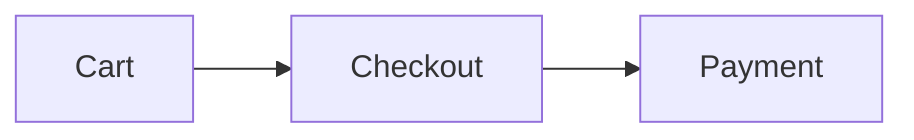
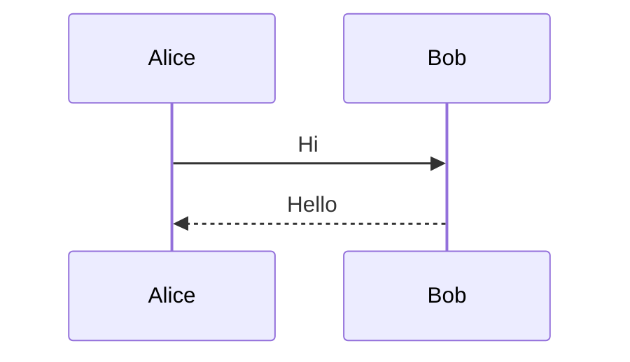
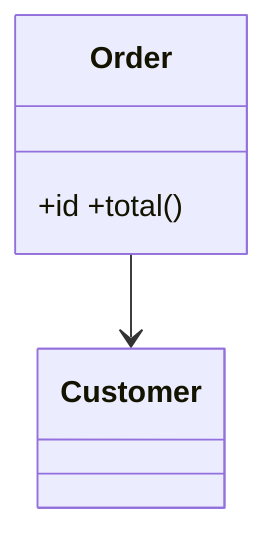
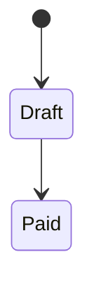

# Order Service – Design

Overview of the **order service**. See the [API](api/openapi.yaml) and the [sequence diagram](sequence.puml).

## Sequence (embedded file)

## Inline diagram

## ArchiMate

ArchiMate works through PlantUML's stdlib (`!include <archimate/Archimate>`), embedded from [archimate.puml](archimate.puml). Click any diagram to zoom into it.

## Flow (Mermaid)

ok this is cool

See also [the full flow](flow.mmd), the [class model](classes.puml) and the [order events](asyncapi.yaml).

## Decisions and other cool things

| # | Decision | Status |
|---|----------|--------|
| 1 | Orders are immutable after payment | accepted |

## More Mermaid types

